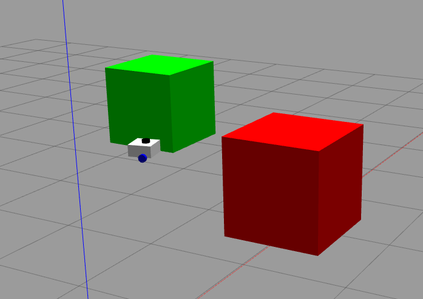
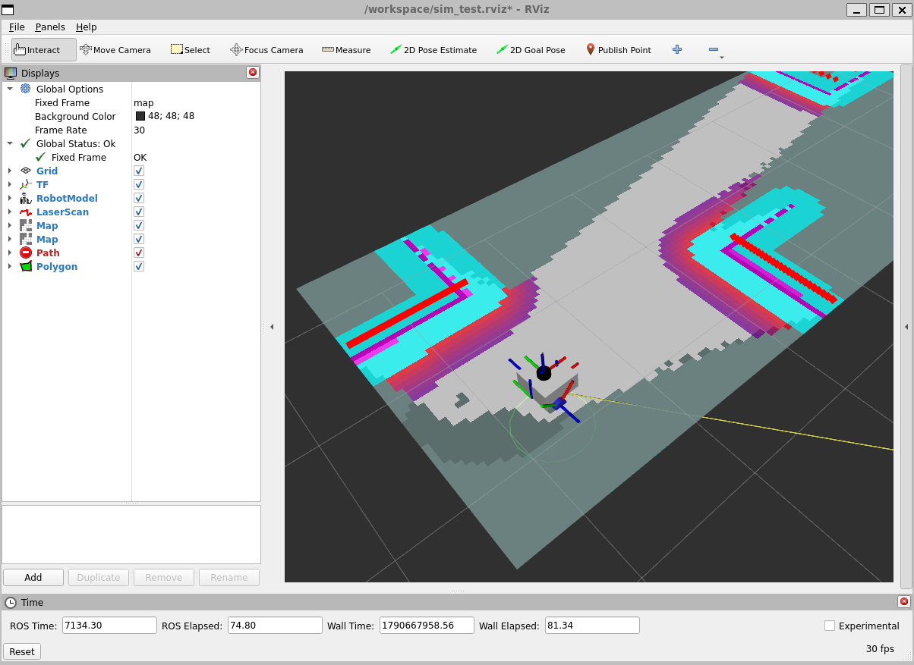

<<<<<<< HEAD
# ROS2 Workspace Template

## Overview

This guide provides a basic setup and usage workflow for developing ROS 2 applications in a Linux environment. It covers setting up **WSL2 and Docker on Windows**, creating and building a ROS 2 workspace, creating and running ROS 2 packages, and configuring communication between multiple devices.

This repository uses **ROS 2 Humble**, which is based on **Ubuntu 22.04 (Jammy)**. Docker is used to provide a consistent Ubuntu environment so that the ROS 2 development environment remains consistent across different machines.


## Table of Contents

1. [Creating a Branch from This Template](#creating-a-branch-from-this-template)
2. [WSL (Windows Subsystem for Linux)](#wsl-windows-subsystem-for-linux)
   - [Install WSL2](#install-wsl2)
   - [Running WSL2](#running-wsl)
3. [Setup Docker](#setup-docker)
   - [Install Docker](#install-docker)
   - [Running the Docker Container](#running-the-docker-container)
4. [ROS2 Workspaces](#ros2-workspaces)
5. [Building the Workspace](#building-the-workspace)
   - [How to Use `colcon build`](#how-to-use-colcon-build)
   - [Useful Options](#useful-options)
   - [Sourcing the Workspace](#sourcing-the-workspace)
6. [How to Create a ROS2 Package](#how-to-create-a-ros2-package)
7. [Running a ROS2 Package](#running-a-ros2-package)
8. [ROS2 Multi-device Communication](#ros2-multi-device-communication)
   - [Verify Communication](#verify-communication)

## Creating a Branch from This Template

This repository's `template_ws` branch serves as a template for creating new ROS 2 workspace branches. Follow these steps to create your own branch based on this template:

### Using Git Command Line
1. Make sure you have the latest version of the repository:
    ```
    git fetch origin
    ```

2. Create a new branch from the `template_ws` branch:
    ```
    git checkout -b <your-new-branch-name> origin/template_ws
    ```
    Replace `<your-new-branch-name>` with your desired branch name (e.g., `my-robot-ws`, `project-x`, etc.)

3. Push your new branch to the remote repository:
    ```
    git push -u origin <your-new-branch-name>
    ```

### Using GitHub Web Interface
1. Navigate to the [upmoon27 repository](https://github.com/chengenli9/upmoon27)

2. Click the **Branch** dropdown button near the top of the page

3. Select the `template_ws` branch from the list

4. Click the **New branch** button (or use the branch selector dropdown)

5. Enter your new branch name and ensure `template_ws` is selected as the source branch

6. Click **Create branch**

7. To work with your new branch locally, pull it:
    ```
    git fetch origin
    git checkout <your-new-branch-name>
    ```

## WSL (Windows Subsystem for Linux)

If you're using a Windows Device and don't have access to a Linux Machine, you can use WSL.
### Install WSL2
In a terminal run:
```
wsl --install
```
This is will install the default Ubuntu distrubution (26.04). Any Ubuntu version is sufficient as long as it's 22.04 or newer. 

After installation completes, restart your computer for the changes to take effect.

### Running WSL

#### Launch WSL
To start WSL and access the Linux environment, open a PowerShell or Command Prompt and run:
```
wsl
```

This will launch the default WSL distribution (usually Ubuntu). You'll be logged in as your default WSL user.

## Setup Docker
ROS2 Humble runs on Ubuntu 22.04 Jammy, so we need to make sure we're running the same package versions. This is where Docker comes in. Docker is a tool that packages your application and all its required settings into a portable, lightweight box called a container. This container acts like a mini-environment that makes sure your code works the exact same way on your laptop, a coworker's computer, or a cloud server.

### Install Docker

1. Update the package index
    ```bash 
    sudo apt update && sudo apt upgrade -y
    ```

2. Install certificates and curl
    ```
    sudo apt install -y apt-transport-https ca-certificates curl
    ```

3. Create directory for keys and download Docker's GPG key
    ```
    sudo install -m 0755 -d /etc/apt/keyrings
    sudo curl -fsSL https://download.docker.com/linux/ubuntu/gpg -o /etc/apt/keyrings/docker.asc
    sudo chmod a+r /etc/apt/keyrings/docker.asc
    ```

4. Add the official Docker repository to your APT sources
    ```
    echo "deb [arch=$(dpkg --print-architecture) signed-by=/etc/apt/keyrings/docker.asc] https://download.docker.com/linux/ubuntu $(. /etc/os-release && echo "$VERSION_CODENAME") stable" | sudo tee /etc/apt/sources.list.d/docker.list > /dev/null
    ```

5. Install Docker Engine
    ```
    sudo apt update
    sudo apt install -y docker-ce docker-ce-cli containerd.io docker-buildx-plugin docker-compose-plugin
    ```

6. Configure Non-Root User Acess
    ```
    sudo usermod -aG docker $USER
    ```
    This will require you to restart WSL. 

7. Verify the Docker service status
    ```
    systemctl status docker
    ```
    If docker is running successfully, it should output this:
    ```bash 
    docker.service - Docker Application Container Engine
     Loaded: loaded (/usr/lib/systemd/system/docker.service; enabled; preset: enabled)
     Active: active (running) since Sun 2026-09-13 19:01:54 PDT; 40min ago
    ```

### Running The Docker Container
1. Navigate to the source directory:
    ```
    cd ~/upmoon27
    ```
2. Build the container:
    ```
    docker compose up -d --build
    ```
3. Run the container:
    ```
    xhost +local:docker
    docker compose exec ros2 bash 
    ```

## ROS2 Workspaces
A standard ROS 2 workspace template directory tree features a root folder containing a src directory for source code, which expands into `build`, `install`, and `log` folders after running a build command

Example: 
```
ros2_ws/
├── build/
├── install/
├── log/
└── src/
    └── my_python_package1/
        ├── my_python_package1/
        ├── resource/
        ├── package.xml
        ├── setup.py
        └── setup.cfg
    └── my_python_package2/
        ├── my_python_package2/
        ├── resource/
        ├── package.xml
        ├── setup.py
        └── setup.cfg
```

For this Repo:
```
upmoon27/
├── build/
├── install/
├── log/
└── src/
    └── test_pkg/
        ├── test_pkg/
        ├── resource/
        ├── package.xml
        ├── setup.py
        └── setup.cfg
```
## Building The Workspace
`colcon build` is a command-line tool used in ROS2 to compile source code, handle package dependencies, and set up the workspace for execution

### How To Use `colcon build`
1. Navigate to the root directory of your ROS2 workspace (e.g., ~/ros2_ws) 
2. Ensure your source packages are inside a subdirectory named `src`.
3. Run the build command:
    ```
    colcon build
    ```
### Useful Options
- Symlink Install: use the `--symlink-install` so that changes to Python or interface files take effect immediately without needing to rebuild every time: 
  ```
  colcon build --symlink-install
  ```

- Select Specific Packages: Build only a specific package instead of the entire workspace:
  ```
  colcon build --packages-select <package_name>
  ```

### Sourcing The Workspace
After building your workspace, you must source the setup files so that ROS2 can find your packages, nodes, and executables 

Navigate to your workspace directory and run the following command:
```
source install/setup.bash
```

## How To Create a ROS2 Package
Navigate to the `/src` folder in your ROS2 workspace.

Run the command:
```
ros2 pkg create --build-type ament_python --license Apache-2.0 <package_name>
```
Verify package structure:
```
my_python_package/
  ├── my_python_package/
  ├── resource/
  ├── package.xml
  ├── setup.py
  └── setup.cfg
```
## Running a ROS2 Package
Make sure you are in the root directory of the workspace and you `colcon build`. 

`ros2 run`: Runs one specific node. Best for quick testing or simple single-node tasks.
```
ros2 run <package_name> <executable_name>
```
Example: Running the `teleop_twist_keyboard`
```
ros2 run teleop_twist_keyboard teleop_twist_keyboard
```

`ros2 launch`: Runs multiple nodes. Use this when you want to spin up an entire robot system (e.g., bringing up a camera driver, a lidar driver, and a mapping node all at once) 
```
ros2 launch <package_name> <launch_file_name>
```
Example: To launch a ros2 tutorial 
```
ros2 launch turtlebot3_gazebo turtlebot3_world.launch.py
```


## ROS2 Multi-device Communication
In ROS 2, nodes communicate across different machines or processes via a ROS Domain ID. By default, all ROS 2 nodes discover each other on Domain 0 because they use the same underlying network subnet and DDS (Data Distribution Service) settings.

To isolate or connect nodes across a network, you change the ROS_DOMAIN_ID environment variable in the terminal before running your node. 

```
export ROS_DOMAIN_ID=27 
```
### Verify Communcation
Device 1: Publisher
```
export ROS_DOMAIN_ID=27
ros2 run demo_nodes_py talker
```

Device 2: Listener
```
export ROS_DOMAIN_ID=27
ros2 run demo_nodes_py listener
```
You can also see if the topic is publishing by running `ros2 topic list`. You should see the following output:
```
/chatter
/parameter_events
/rosout
```

=======
# Gazebo Simulation

Autonomy pipeline: SLAM Toolbox + Nav2

## Packages
All the following packages are located in the `/src` folder:
| Package | Purpose |
| --- | --- |
| `rover_description` | URDF/Xacro robot model, Gazebo launch, and robot_state_publisher |
| `rover_slam` | SLAM Toolbox configuration and launch files for mapping and localization |
| `rover_navigation` | Nav2 configuration and launch files; intended to use SLAM Toolbox for localization instead of AMCL |
| `rover_bringup` | Top-level launch files combining the robot description, SLAM, and navigation |


## Getting Started

### Docker Container
Setup the ROS2 environment. Run Docker scripts on the host, then run the ROS2 scripts inside the container. Each script contains a comment and Bash command for ease of use. Use `bash SCRIPT.sh` to run it.

1. Navigate to root directory.
    ```bash
    cd ~/upmoon27
    ```
2. Build Container from the host terminal.
    ```bash
    bash build_docker.sh
    ```
    Will take a few minutes.
3. Open a container terminal.
    ```bash
    bash start_docker.sh
    ```

4. Build the packages and then source the workspace.
    ```bash
    bash source.sh
    bash colcon.sh

Your environment is set up!

### Run Gazebo & Spawn Assets

For each new terminal, run `bash start_docker.sh` from the host repository root. Inside the container, navigate to the workspace and source the environment before running a ROS2 script:

```bash
# IMPORTANT
bash source.sh
```

Replace the example container path with your actual workspace path. These scripts do not source the environment automatically.

1. Terminal 1: Run Gazebo & Spawn robot URDF model.
    ```bash
    bash start_sim.sh
    ```
    This will launch Gazebo software with the default `obstacle.world` file, which can be found in the `gz_worlds` folder. It will also spawn the robot.

    

2. Terminal 2: View in RViz2.
    ```bash
    bash start_rviz.sh
    ```
    This opens RViz2 with the `sim_test.rviz` configuration.

    

3. Terminal 3: Control the robot with Keyboard.
    ```bash
    bash teleop_keyboard.sh
    ```
    This will run the default ROS2 `teleop_twist_keyboard` node. Focus this terminal and make sure Gazebo is playing. Use `i` to move forward, `,` to reverse, `j`/`l` to turn, and `k` to stop.

### Run SLAM for Mapping

1. Terminal 4: Run SLAM toolbox node inside a sourced container terminal.
    ```bash
    bash start_slam.sh
    ```
2. Move the robot around the world, and watch as the occupancy map grows.

### Run Full Pipeline (Gazebo + SLAM + Nav2) (NOT WORKING)

This is intended to run in a single terminal. It launches the simulation and SLAM with the addition of Nav2.

```bash
ros2 launch rover_bringup sim_bringup.launch.py
```

Run this command inside a sourced container terminal. The combined launch is still under development. Do not run it alongside the separate simulation and SLAM launches.

## Command Cheat Sheet

### Scripts

Run Docker scripts from the repository root on the host. Run the other scripts from the workspace inside a sourced container terminal.

| Command | Where  | Purpose |
| --- | --- | --- |
| `bash build_docker.sh` | Host | Build the image and start the container |
| `bash start_docker.sh` | Host | Open an interactive container shell |
| `bash colcon.sh` | Container | Build all ROS2 packages |
| `bash start_sim.sh` | Container | Launch Gazebo and spawn the robot |
| `bash start_rviz.sh` | Container | Open RViz2 |
| `bash teleop_keyboard.sh` | Container | Start keyboard control |
| `bash start_slam.sh` | Container | Start SLAM mapping |

After rebuilding, run `bash source.sh` again and restart affected nodes. Restart the simulation after changing Xacro or Gazebo plugin settings.

### Docker — Host Terminal

| Command | Purpose |
| --- | --- |
| `docker compose ps` | Check container status |
| `docker compose config --services` | List service names |
| `docker compose exec ros2 pwd` | Check the default directory inside the container |
| `docker compose up -d ros2` | Start the ROS2 service |
| `docker compose logs --tail=100 ros2` | View recent container logs |
| `docker compose stop ros2` | Stop the container |
| `docker compose down` | Remove project containers and networks |

Avoid `docker compose down -v` unless you intend to delete named volumes. If the service has a different name, update the Docker scripts and substitute that name in these commands.

### ROS2 — Container Terminal

Open a container terminal with `bash start_docker.sh`, navigate to the workspace, and source ROS2 and `install/setup.bash` before running these commands.

| Command | Purpose |
| --- | --- |
| `ros2 node list` | List running nodes |
| `ros2 topic list -t` | List topics and message types |
| `ros2 topic info /cmd_vel --verbose` | Inspect velocity publishers and subscribers |
| `ros2 topic echo /cmd_vel` | Watch keyboard velocity commands |
| `ros2 topic hz /scan` | Check laser scan frequency |
| `ros2 topic hz /odom` | Check odometry frequency |
| `ros2 topic echo /clock --once` | Check the simulation clock |
| `ros2 run tf2_ros tf2_echo odom base_link` | Inspect the odometry-to-robot transform |
| `ros2 param get /slam_toolbox use_sim_time` | Check SLAM's simulation-time setting |

Topic and node names may differ with your configuration. Use Ctrl+C to stop continuous output.

### Helpful Repository Commands — Host Terminal


Run scripts with `bash SCRIPT.sh`; execute permissions and a shebang are not required when Bash is invoked explicitly.
>>>>>>> remotes/origin/gazebo_testing_wes
